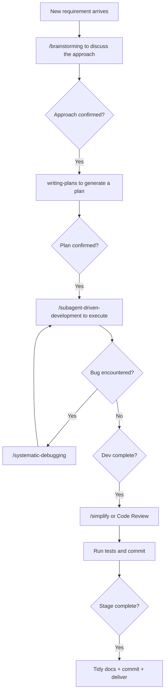

## Scope

A personal SOP for building agent products with AI Coding. Currently in the PoC accumulation phase: validating techniques, capturing processes and recording experience. Useful as a personal quick reference, or as a step-by-step guide for newcomers.

## 0. Core principles

1. **Discuss thoroughly before starting**: writing code before the plan is confirmed usually means rework.
2. **Framework first, details later, iterate incrementally**: go PoC → MVP → V1.0, adding features on top of the existing framework each step.
3. **AI output must be reviewed by a human**: the developer must review what AI produces.
4. **Debug systematically**: no guess-fixes; verify layer by layer, then fix the root cause.

## 1. Tooling foundation: Claude Code + Superpowers

### 1.1 Core commands

| Command | What it does | Best time to use |
| --- | --- | --- |
| `/compact` | Proactively compact context to free space | After finishing a task; when context exceeds ~60%. Say what to keep: current goal, completed items, remaining TODOs |
| `/security-review` | Security review | When there's SQL injection, XSS, auth/authz, unsafe data handling, dependency-vulnerability risk |
| `/context` | Check context usage | When tasks slow down or the model starts drifting |

### 1.2 Bundled skills

| Command | Mechanism | Usage |
| --- | --- | --- |
| `/simplify` | Three-agent parallel review: reusability, quality, efficiency | `/simplify` for everything; `/simplify ClassName` for a specific module |
| `/loop` | Scheduled or autonomous iteration until the goal is reached | `/loop 30m /review`; `/loop "fix all tests until they pass"` |
| `/debug` | Diagnose Claude Code itself | On MCP connection, tool-call or permission issues; run first when CC hangs or errors |

### 1.3 Usage habits

| Trick | Usage | Tip |
| --- | --- | --- |
| `@file` / `@folder/` | Pin context | Use confirmed material dirs; avoid vague instructions and cut token use |
| `btw` questions | Side conversations | Look up API usage or syntax without polluting the current task context |
| `--dangerously-skip-permissions` | Skip confirmation | For personal practice only |
| `/compact + keep-scope` | Proactive compaction | Use past 60% context, explicitly keep current goal, done items and TODOs |

### 1.4 Superpowers skills quick reference

> If there's even a 1% chance it applies, you must invoke it. Use process skills (e.g. brainstorming, debugging) to decide "how", then implementation skills (e.g. TDD, writing-plans) to guide execution. Rigid skills like TDD, debugging and verification must not be skipped.

| Skill | When | One-liner |
| --- | --- | --- |
| `brainstorming` | Before any new feature, design or creative work | Clarify → compare 2–3 options → pick → output a spec |
| `systematic-debugging` | Bugs, exceptions, unexpected behavior | Root cause → pattern → hypothesis → fix; no guess-fixes |
| `test-driven-development` | Before implementing a feature or fixing a bug | RED → GREEN → REFACTOR, write a failing test first |
| `writing-plans` | Spec exists, about to code | A step-by-step plan with file layout, steps and test strategy |
| `subagent-driven-development` | Executing a plan | Each task done by an independent subagent, with two-phase review |
| `dispatching-parallel-agents` | Two+ independent tasks can run in parallel | One agent per problem domain, no interference |
| `executing-plans` | Executing a plan without subagents | Load plan → run task by task → verify |
| `verification-before-completion` | About to claim done | Without verification evidence, you can't say "passed" |
| `requesting-code-review` | Feature done or before merge | An independent reviewer removes author blind spots |
| `receiving-code-review` | When you get review feedback | Understand → verify → assess → implement; no emotional or blind acceptance |
| `finishing-a-development-branch` | Implementation done, ready to integrate | After tests pass, choose merge / PR / cleanup |
| `using-git-worktrees` | When you need isolation | Detect existing isolation, prefer native tools, fall back to worktrees |
| `writing-skills` | Creating or editing skill files | Apply TDD to docs: write scenarios → see failure → write the skill |
| `using-superpowers` | At the start of every conversation | Establish skill-discovery rules to avoid missing one |

### 1.5 Choosing between `/simplify` and code review

| Scenario | Prefer | Why |
| --- | --- | --- |
| Just refactored a function, want to confirm no redundancy | `/simplify` | Runs reusability/quality/efficiency checks, fixes dead imports, duplicate logic |
| Finished a complex module, about to merge into main | `requesting-code-review` | An independent reviewer reduces author blind spots |
| A teammate left multiple PR comments | `receiving-code-review` | Verify each and assess technically; accept or push back |
| Finishing code late at night, want a self-check | `/simplify` | No human needed, AI self-checks |

Common workflow combos:

- New feature: `brainstorming → writing-plans → subagent-driven-development → verification`
- Bug fix: `systematic-debugging → test-driven-development → verification`
- Refactor: `writing-plans → subagent-driven-development → requesting-code-review`

## 2. Before coding: research and design

### 2.1 A methodology for AI-assisted framework selection

**Step 1 — Clarify requirements and constraints (align inputs)**: turn the business scenario into selection criteria. Describe business context, team stack, deployment environment and performance/security needs; ask AI to extract dimensions (language ecosystem, multi-agent, MCP support, production readiness, community activity) and flag any "deal-breaker".

**Step 2 — Cast a wide net (information gathering)**: without pre-committing to a language, ask AI to collect mainstream and emerging frameworks grouped by language, list 6–8 candidates (commercial or open source), and produce an initial screen on multi-agent collaboration, MCP/A2A ecosystem, production readiness and learning curve.

**Step 3 — Deep compare and business mapping (analysis)**: provide user roles, core flows and growth expectations; ask AI to map each candidate to your business, do a gap analysis, propose an architecture and recommend inclusions/exclusions with a fit score.

**Step 4 — Cross-validate and challenge (elimination)**: actively challenge the recommendation ("why not X?"), distinguish native/community/demo/production capabilities, and ask AI to draw an architecture diagram to check coherence.

**Step 5 — Produce the decision doc (close the loop)**: a reportable, executable conclusion — candidate comparison, recommendation, risks, rollout roadmap, one-line conclusion and reasons for exclusions.

**Key principles**:

| Principle | Meaning |
| --- | --- |
| Diverge then converge | Step 2 doesn't constrain languages; Step 3 filters by business |
| Use AI skeptically | AI may confuse community vs. official editions; require sources for key claims |
| Mix text and diagrams | Use Mermaid for complex architectures; easier to spot contradictions |
| Iterate and dig | When one round is insufficient, keep researching docs/source for key frameworks |

### 2.2 PRD and design

PRD follows: **north star → PoC → MVP → release**.

**The /brainstorming design SOP**:

| Task | Tool | Notes |
| --- | --- | --- |
| Map product needs and feasibility | `/brainstorming` | AI advises, the developer gates |
| Provide background material | `@docs/` for files/dirs | Include relevant design docs, API docs and competitor material |
| Discuss and pick among 2–3 approaches | brainstorming guide | Focus on extensibility and cost |
| Output the technical design | `/writing-plans` + human review | Review, revise, archive |

Steps: drop background into `docs/` → load requirements with `@docs/...` → `/brainstorming` → confirm scope, selection, module split, interfaces → `/writing-plans` for the design doc.

**Practice notes**: use progressive plans for complex problems (PoC with zero infra → MVP with light infra → V1.0 with platform collaboration); raise security/performance constraints during brainstorming; save designs to `docs/`.

## 3. During development: coding, integration and debugging

### 3.1 The dev flow

| Task | Tool | Notes |
| --- | --- | --- |
| Implement module by module | `/subagent-driven-development` | Each task in its own subagent |
| Provide background knowledge | `@docs/` | Load docs, designs and pitfall records |
| Gate code quality | `/requesting-code-review` + `/receiving-code-review` + `/simplify` | Make it correct first, then clean it up |

Steps: generate a plan from the design with `writing-plans` → execute with `/subagent-driven-development` → per module, run tests + `/review` → use `/verification-before-completion` at key points → run `/simplify` every 3–5 tasks → switch to the debugging SOP on bugs → record key decisions to `docs/`.

**Incremental principles**: add to the existing framework, never rebuild from scratch; humans lock the interface contract, AI handles implementation details; get the happy path working first, then edge cases.

### 3.2 Debugging: `/systematic-debugging`

The core path: **root cause → pattern analysis → hypothesis → fix**.

| Stage | Action | Hard rule |
| --- | --- | --- |
| 1. Root cause | Read the full error; test layer by layer; trace the data flow | No fix before finding the root cause |
| 2. Pattern analysis | Find a working example and compare, locate the difference | Don't assume "that doesn't matter" |
| 3. Hypothesis | Form one hypothesis, test with a minimal change | One change at a time |
| 4. Implement the fix | Single-point fix → verify; 3 consecutive failures → question the architecture | No stacking fixes |

**MCP / API extras**: `curl` the MCP endpoint raw first to confirm the protocol layer, then debug business logic; mind the `Accept` header; watch session management (some MCP servers need an `initialize` handshake).

### 3.3 Project lifecycle

| Stage | Goal | Key deliverable |
| --- | --- | --- |
| PoC | Validate feasibility, run the core path end-to-end | Technical design + runnable demo |
| MVP | Complete the core features, usable internally | Full core features + basic monitoring |
| V1.0 | Production-ready for performance, security and ops | Full deployment + SLA + complete docs |

Start each stage with `/brainstorming` to confirm the approach; finish with full archiving.

## 4. After development: delivery and archiving

| Task | Acceptance | Notes |
| --- | --- | --- |
| Confirm build/tests pass | `go build ./...`, `go test ./...` | Must actually run green |
| Docs complete | Check `docs/` subdirs | At least README, design doc, pitfalls guide |
| Tidy git history | Split commits logically | `feat` / `fix` / `docs` / `chore` separated |
| Environment doc | Check `.env.example` | Commented well enough for a newcomer to copy |

Commit conventions: `feat:` new feature | `fix:` fix | `docs:` docs | `chore:` build/config.

## Appendix: quick decision tree

