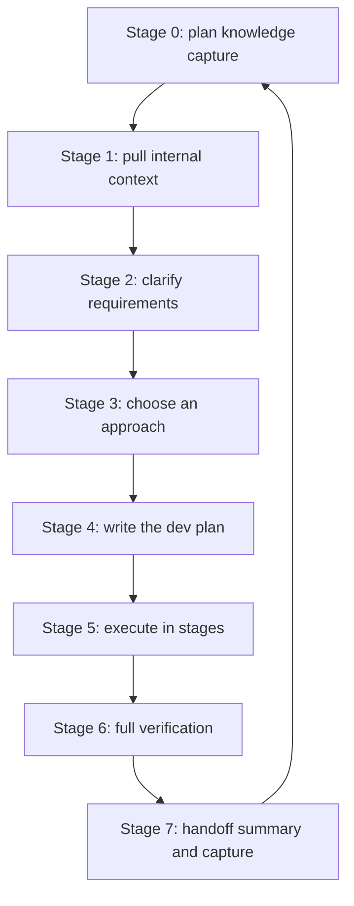
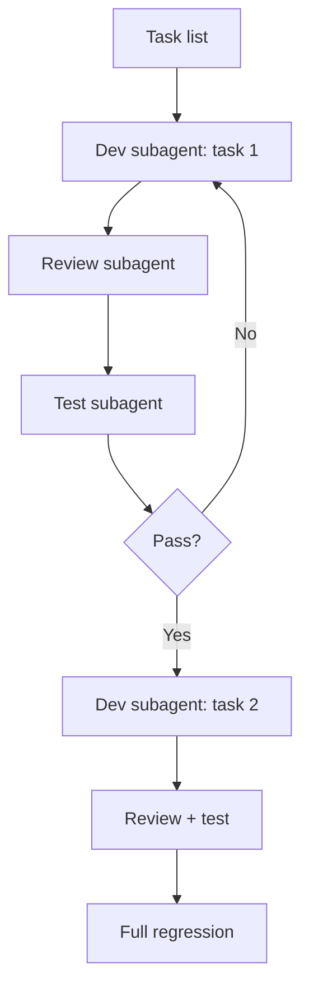

## The one-sentence method

**Don't just tell AI to write code.** Pull context and clarify first, then propose a solution, write a plan, execute in stages, and finally prove the result correct with tests and acceptance criteria.

## Who this SOP is for

**Intended reader**: someone using AI for real development for the first time. No need to understand Agent, MCP or Skills up front — just prepare materials, follow the tools in order, and produce each stage's output.

**When it applies**:

- Building an internal platform or new module from 0 to 1;
- Implementing a feature, fixing a bug, doing a small refactor;
- You've thrown a one-liner at AI before and got unstable quality, and want a stable method.

**What you'll gain**:

- Knowing what docs and context to prepare before coding;
- Knowing when to pull internal docs vs. apply engineering-discipline skills;
- Reusable prompt templates for each stage;
- A delivery quality checklist;
- The ability to run your own controlled experiment comparing "processed input" vs. "one-line input".

## Core principles

1. **AI is a context-hungry collaborator, not an autocomplete.** Business terms, historical decisions, private interfaces and team conventions aren't in the training data; the less context, the more AI guesses with generic experience.
2. **Decide what to build before how to build it.** Coding with unclear requirements is the root of rework.
3. **Light process for simple tasks, heavy process for complex ones.** Process intensity should match the risk of the change.
4. **"Done" requires evidence.** Before delivery, record the tests, commands and interface/page checks you ran, plus what's left uncovered.

## Tool division of labor

| Tool | Problem it solves | When to use it |
| --- | --- | --- |
| Internal docs / knowledge-base skills | Provide team context and persist coding-project context | Read requirement docs, tech plans, interface docs, meeting notes, past reviews; retrieve past approaches and pitfalls; write conclusions back |
| Superpowers | Give AI engineering discipline, break work into stages | Clarify, compare options, plan, implement in stages, debug, verify, pre-delivery check |

In one sentence: **internal docs answer "what AI should know", Superpowers answer "how AI should do it".**

## Before you code: the input package

More isn't automatically better; the input package just needs AI to know: what the project is, what the requirement is, where the code lives, and what counts as done.

**Must-have information**:

- Project background and users;
- Requirement source (requirement doc, bug ticket);
- The modules, pages, interfaces, services or directories involved;
- Interface and data field info;
- Acceptance criteria: normal, exceptional, boundary — plus old behavior you must not break;
- Local start/test/build commands (ask AI to find them from the repo if unknown).

**Nice-to-have** : design mockups, prototypes, screenshots; past technical plans and reviews; production error logs; existing test locations; legacy logic and no-touch ranges; rollout and rollback requirements.

**Input package template**:

```text
I'm about to start a development task. Please read and organize the context first; don't write code yet.

Project background:
[what the project does, who the users are; write a short version if none]

Requirement source:
[paste the requirement, or link the requirement doc / bug ticket]

Relevant modules:
[the pages, interfaces, services, components, directories involved]

Interfaces and data:
[field descriptions, return examples; write "none, analyze from the code" if unsure]

Acceptance criteria:
1. [normal case]
2. [exceptional case]
3. [boundary case]
4. [old behavior that must not break]

Local verification:
[start/test/build commands; if unknown, let AI find them from the repo]

Please first output:
1. The project background as you understand it
2. The requirement goal as you understand it
3. Relevant code entry points
4. Main risks and uncertainties
5. Whether the current info is enough to start; if not, what docs/links are missing, and which code you'd read first to reverse-summarize
```

> It's fine to start with incomplete info: don't stop entirely because "material is missing". Delegate the "is the info enough" judgement to AI — let it identify the gaps first, then decide what to fetch.

## The standard closed loop: 8 stages



Don't move to the next stage until the previous stage's output is confirmed. Stage 0 decides what to capture; Stages 1–6 record continuously; Stage 7 assembles everything into a handoff package.

### Stage 0: plan knowledge capture

Before starting, decide what to leave behind, where to archive it, and when to record it. This inventory is also Stage 7's acceptance checklist. Recommended `docs/` layout:

```text
docs/
├── README.md         # entry point: reading path and maintenance rules
├── overview/         # overview: product, architecture, domain model, stack, progress
├── references/       # upstream snapshots: source of truth for requirements
├── decisions/        # key technical & business decisions (ADRs)
├── design/           # long-lived module design: models, schemas, state machines
├── api/              # interface contracts and conventions
├── runbooks/         # dev, integration, debugging, ops manuals
├── pitfalls/         # verified pitfalls and workarounds
├── handoff/          # staged handoff index
└── superpowers/      # archived specs/plans, not the current source of truth
```

### Stage 1: pull internal context

If the requirement lives in a doc, requirement sheet or bug ticket, hand AI the link to read — don't rely on memory-retold summaries.

### Stage 2: clarify requirements

Let AI state how it understands the requirement before discussing implementation.

```text
Clarify the requirement using a brainstorming approach. Don't write code.

Output:
1. Your understanding of the requirement
2. The scope you will do
3. The scope you will NOT do
4. Points you find ambiguous
5. Questions I need to answer

Do not move to implementation before I confirm.
```

Beginners must confirm: who the user is, what the main flow is, how it behaves on exceptions, where the data comes from and what the fields mean, how success/failure is shown, and which old features must stay untouched.

### Stage 3: choose an approach

For complex tasks, compare at least 2–3 options instead of letting AI hand you a single answer.

```text
Give me 2–3 approaches and compare them.

Each approach must include:
1. The idea
2. Which files/modules change
3. Pros
4. Cons
5. Risks

Finally, recommend one and why.

After I pick one, write an ADR ("candidates + which one + why + how to roll back")
to docs/decisions/{next-number}-{short-name}.md. Increment the highest existing number; never reuse.
```

A beginner's priority order: match existing style → smaller blast radius → easier to test/roll back → no unnecessary abstraction or dependency.

### Stage 4: write the dev plan

After the approach is confirmed, ask AI for a plan concrete to files and steps.

```text
Write a dev plan based on the confirmed approach.

The plan must include:
1. The list of files to change
2. What changes in each file
3. Execution order
4. Tests to add or update
5. A checkpoint after each step
6. Final verification commands
7. Risks and rollback

Wait for my confirmation after writing; don't execute yet.
```

### Stage 5: execute in stages

With subagent-driven development, the main AI orchestrates like a PM: a dev subagent implements, a review subagent independently reviews, a test subagent independently verifies. Serial by default; parallel only when tasks are independent.



When tasks are independent you can parallelize, but first have AI list: which task groups can run in parallel, each subagent's boundary (files it may / may not touch), and which tasks must be serial. Every subagent still goes through review + test.

Keep an eye on: out-of-plan file changes, whether Critical/Important review issues are truly fixed, whether tests show commands and output, and whether direction drifts after task 3/4. Pause at once on drift, and ask for a minimal correction that re-aligns with the original requirement and plan.

### Stage 6: full verification

Per-task review and tests only prove local correctness; this stage owns the overall acceptance.

```text
Verify using a verification-before-completion approach.

Output:
1. Which verification commands you ran
2. The result of each
3. Which acceptance criteria are covered
4. Which criteria have no automated coverage yet
5. What I should check manually
6. Remaining risks

If you didn't run verification, don't say "done".
```

> **Beginner trap**: passing tests ≠ verified. Ask which acceptance criteria the tests map to, and which critical paths are still uncovered.

### Stage 7: handoff summary and knowledge capture

Stage 7 is done when every item in the Stage 0 inventory has a corresponding file, and it passes an "outsider" check. "AI said done" isn't done; every checkbox ticked is done.

The delivery summary should cover four parts: a task summary (what / which files / how verified / what was skipped / rollback / remaining risks), the inventory items produced one by one, a handoff index, and an inventory-vs-actual table. Finish by running an "outsider view" prompt to verify the handoff package is complete.

## Choosing process by task complexity

| Scenario | Fits | Recommended stages | Key requirement |
| --- | --- | --- | --- |
| A: simple change (light) | copy, styles, logs, config, small decision logic | Skip 1–4, start at 5; short summary after minimal verification | Limit file scope; no opportunistic refactors; keep change & verification evidence |
| B: bug / small tweak (standard) | failing tests, prod exceptions, adding a field/state/interface | Maybe 1; must do 2; compare only 1–2 options in 3; full 4–7 | Reproduce before fixing; follow existing style; don't sneak in new frameworks |
| C: core path / cross-module / new module (full) | multi-module, prod-stability risk, 0→1 module | Full 1–7 | Must read original docs; compare 2–3 options; plan includes rollback; prefer subagent three-phase; full regression |

## Common beginner mistakes

| Mistake | Problem | Fix |
| --- | --- | --- |
| One natural-language sentence | AI doesn't know users, data, operations or acceptance | Fill the input-package template |
| One sentence asking for everything | AI skips clarify and plan; drift is invisible | Do clarify → plan → implement → verify in stages |
| No acceptance criteria | "fix it" can't define done | Specify normal, exceptional, boundary and legacy-compat requirements |
| Treating "ran tests" as verified | Tests are only one piece of evidence, may miss critical paths | Map tests to criteria and uncovered risks |
| Retelling requirements from memory | Second-hand description drops key constraints | Have AI read the original doc directly |

## The experiment framework

You can validate this SOP with a controlled experiment: same task, one group "hands it to AI in one sentence", the other "feeds it through the SOP".

| Dimension | A: one-line input | B: processed input |
| --- | --- | --- |
| Requirement input | One task sentence | Input package + context + clarify + options + plan, in rounds |
| Working method | Code directly | Use engineering skills; confirm stage output before continuing |
| Task difficulty | light / standard / full | Same task, same acceptance criteria |

**Suggested metrics** : acceptance rate, exceptional-scenario coverage, out-of-plan changes, rework count, total time, first-pass approval rate, critical-path test coverage, completeness of approach & rollback.

## The final checklist

**Before coding** : project background ready; requirement doc or clear requirement provided; modules & directories described; normal/exceptional/boundary criteria written; start/test/build commands provided; AI has stated its understanding and uncertainties.

**During coding** : options compared and plan confirmed for complex tasks; files to change explicit; parallel subagents have explicit scope & acceptance; independent review and tests run after completion; AI didn't silently expand scope.

**Before delivery** : core & exceptional paths implemented, legacy unbroken; tests added or updated; Critical/Important review issues fixed; verification commands & results recorded; uncovered risks stated; Stage 0 inventory ticked against actual artifacts.

## The repos behind this SOP

This SOP isn't an original methodology — it wires the community's most mature engineering skills into a flow. The core is **Superpowers**:

- [obra/superpowers](https://github.com/obra/superpowers): the well-known methodology plugin for Claude Code, shipping a full skill chain from clarification to delivery — `using-superpowers`, `brainstorming`, `writing-plans`, `executing-plans`, `subagent-driven-development`, `test-driven-development`, `verification-before-completion`, `requesting-code-review`, and more. Each step above is one of its skills.
- Companion [obra/superpowers-marketplace](https://github.com/obra/superpowers-marketplace) is the official plugin marketplace. In Claude Code, run `/plugin marketplace add obra/superpowers-marketplace`, then `/plugin install superpowers@superpowers-marketplace`.
- The community-editable [obra/superpowers-skills](https://github.com/obra/superpowers-skills) lets you fork it and contribute new skills or improvements.

In one sentence: **processed input = Superpowers' methodology + your project context.** It turns each step of "clarify → propose → plan → execute → accept" into a reusable skill — which is exactly why this SOP is predictable, not luck.