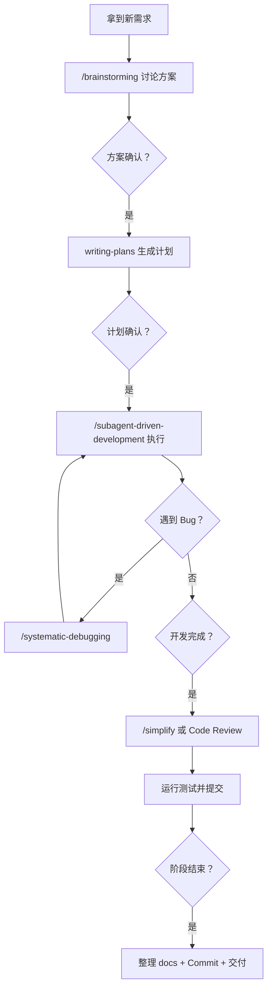

## 适用范围

面向使用 AI Coding 开发智能体产品的个人 SOP。当前处于 PoC 积累期：技术验证、流程沉淀与经验记录。适合自己速查，也可让零经验新人按步骤执行。

## 0. 核心原则

1. **前期讨论清楚再动手**：方案未确认就写代码，通常意味着返工。
2. **先框架后细节，增量迭代**：按 PoC → MVP → V1.0 推进，每一步在已有框架上加功能。
3. **AI 产出必须人审**：开发者必须审核 AI 输出。
4. **调试遵循系统方法**：不猜测修复；分层验证，定位根因后再修改。

## 1. 工具基础：Claude Code + Superpowers

### 1.1 核心命令

| 命令 | 作用 | 最佳使用时机 |
| --- | --- | --- |
| `/compact` | 主动压缩上下文，释放空间 | 完成一个任务后；上下文占用超过 60% 时。压缩时说明保留范围：当前目标、已完成内容、剩余 TODO |
| `/security-review` | 安全审查 | 有 SQL 注入、XSS、认证授权、不安全数据处理、依赖漏洞等风险时 |
| `/context` | 查看上下文占用 | 任务变慢或开始"变飘"时 |

### 1.2 Bundled Skills

| 命令 | 机制 | 用法 |
| --- | --- | --- |
| `/simplify` | 三 Agent 并行审查：复用性、质量、效率 | `/simplify` 全量；`/simplify ClassName` 指定模块 |
| `/loop` | 定时调度或自主迭代直到目标达成 | `/loop 30m /review`；`/loop "修复所有测试直到通过"` |
| `/debug` | 排查 Claude Code 自身问题 | MCP 连接、工具调用或权限异常；CC 卡住/报错时优先运行 |

### 1.3 使用习惯

| 技巧 | 用法 | 建议 |
| --- | --- | --- |
| `@文件` / `@文件夹/` | 指定上下文 | 用已确认的资料目录，避免口语化模糊指令并减少 Token 消耗 |
| `btw` 问题 | 临时对话 | 查询 API 用法、语法等小问题，不污染当前任务上下文 |
| `--dangerously-skip-permissions` | 跳过确认 | 仅个人练手时使用 |
| `/compact + 保留范围` | 主动压缩 | 超过 60% 上下文时使用，明确保留当前目标、已完成项和 TODO |

### 1.4 Superpowers Skills 速查

> 只要有 1% 概率适用就必须调用。优先使用流程技能（如 brainstorming、debugging）确定"怎么做"，再使用实现技能（如 TDD、writing-plans）指导执行。TDD、debugging、verification 等刚性技能不得跳步。

| Skill | 何时使用 | 一句话说明 |
| --- | --- | --- |
| `brainstorming` | 所有新功能、设计或创意工作前 | 需求澄清 → 2–3 个方案对比 → 选定 → 输出 Spec |
| `systematic-debugging` | Bug、异常或非预期行为 | 根因调查 → 模式分析 → 假设验证 → 修复；禁止猜修 |
| `test-driven-development` | 实现功能或修 Bug 前 | RED → GREEN → REFACTOR，先写会失败的测试 |
| `writing-plans` | 已有 Spec，准备编码前 | 生成分步实施计划，含文件结构、步骤和测试策略 |
| `subagent-driven-development` | 执行实施计划 | 每个 Task 交由独立子代理完成，并做双阶段 Review |
| `dispatching-parallel-agents` | 两个及以上独立任务可并行时 | 每个问题域一个 Agent，互不干扰并行推进 |
| `executing-plans` | 无子代理环境执行计划 | 加载计划 → 逐 Task 执行 → 验证 |
| `verification-before-completion` | 准备宣告完成前 | 没有验证证据，就不能说"通过" |
| `requesting-code-review` | 功能完成或合并前 | 独立 Reviewer 消除作者盲区 |
| `receiving-code-review` | 收到 Review 反馈时 | 理解 → 验证 → 技术评估 → 实施，避免情绪化或盲目接受 |
| `finishing-a-development-branch` | 实现完成，准备集成时 | 验证测试后选择 merge、PR 或 cleanup |
| `using-git-worktrees` | 需要隔离工作区 | 先检测已有隔离，优先原生工具，再 fallback 到 Git worktree |
| `writing-skills` | 创建或编辑 Skill 文件时 | 将 TDD 用于文档：写测试场景 → 验证失败 → 编写 Skill |
| `using-superpowers` | 每次对话开始 | 建立 Skill 发现规则，避免遗漏 |

### 1.5 `/simplify` 与 Code Review 的选择

| 场景 | 优先使用 | 原因 |
| --- | --- | --- |
| 刚重构一个函数，想确认无冗余 | `/simplify` | 自动做复用、质量、效率三维检查，可修复无用 import、重复逻辑等 |
| 完成复杂模块，准备合入 main | `requesting-code-review` | 独立 Reviewer 审视，减少作者盲区 |
| 同事在 PR 留了多条意见 | `receiving-code-review` | 逐条验证与技术评估，决定接受或反驳 |
| 深夜完成代码，想先自查 | `/simplify` | 无需真人参与，AI 自查即可 |

常用流程组合：

- 新功能：`brainstorming → writing-plans → subagent-driven-development → verification`
- 修 Bug：`systematic-debugging → test-driven-development → verification`
- 重构：`writing-plans → subagent-driven-development → requesting-code-review`

## 2. 开发前：调研与方案设计

### 2.1 AI 辅助框架选型方法论

**Step 1：明确需求与约束（输入对齐）**——把业务场景转换成技术选型标准。向 AI 描述业务背景、团队技术栈、部署环境、性能/安全要求，要求其提炼选型维度（语言生态、多 Agent 能力、MCP 支持、生产就绪度、社区活跃度），并指出"一票否决项"。

**Step 2：广撒网调研（信息收集）**——先不预设语言，要求 AI 搜集主流和新兴框架，按语言分类，列出 6–8 个候选（商业/开源均可），按多 Agent 协作、MCP/A2A 生态、生产就绪度、学习曲线输出初筛表。

**Step 3：深度对比与业务映射（方案分析）**——提供用户角色、核心功能流、扩展预期，要求 AI 对每个候选做业务映射、Gap 分析、架构建议和排除建议，输出适配度评分表。

**Step 4：交叉验证与答疑（排除法）**——主动挑战推荐结果（"为什么不是 X？"），区分官方原生实现、社区方案、Demo 能力与生产级能力，并要求 AI 绘制架构图检查模块划分是否自洽。

**Step 5：输出决策文档（固化结论）**——形成可汇报、可执行的选型结论：候选对比表、推荐方案、风险点、落地路线图、一句话结论及排除原因。

**选型关键原则**：

| 原则 | 说明 |
| --- | --- |
| 先发散后收敛 | Step 2 不限制语言/框架，Step 3 再以业务场景过滤 |
| 带着质疑使用 AI | AI 可能混淆社区版与官方版；关键结论必须要求来源或官方文档链接 |
| 图文结合 | 复杂架构用 Mermaid；比纯文字更易发现模块矛盾 |
| 迭代深挖 | 一轮对话不足时，针对关键框架继续调研官方文档/源码 |

### 2.2 PRD 与方案设计

PRD 产出遵循：**北极星 → PoC → MVP → 正式版本**。

**/brainstorming 方案设计 SOP**：

| 做什么 | 用什么 | 注意事项 |
| --- | --- | --- |
| 梳理产品需求与技术可行性 | `/brainstorming` | AI 提供建议，开发人员必须把关 |
| 提供背景资料 | `@docs/` 指定文件/目录 | 传入相关设计文档、API 文档和竞品资料 |
| 讨论 2–3 个技术方案并选定 | brainstorming 引导 | 重点关注可扩展性与实现成本 |
| 输出技术设计文档 | `/writing-plans` + 人工审核 | 审核修改后归档 |

步骤：背景资料放入 `docs/` 对应子目录 → 用 `@docs/相关文档` 加载需求或背景 → `/brainstorming` 启动讨论 → 逐步确认功能范围、技术选型、模块拆分、接口定义 → `/writing-plans` 输出技术设计文档。

**实战要点**：复杂问题用递进方案（PoC 零基建快速验证 → MVP 轻量基建 → V1.0 平台协作）；在 brainstorming 中主动提出安全与性能约束；设计文档保存至 `docs/`，讨论过程沉淀为方案对比表。

## 3. 开发中：编码、集成与调试

### 3.1 开发流程

| 做什么 | 用什么 | 注意事项 |
| --- | --- | --- |
| 按计划逐模块实现 | `/subagent-driven-development` | 每个 Task 使用独立子代理 |
| 提供背景知识 | `@docs/` | 加载文档、技术设计和踩坑记录 |
| 代码质量把关 | `/requesting-code-review` + `/receiving-code-review` + `/simplify` | 先确保正确，再清理代码 |

步骤：基于技术设计文档用 `writing-plans` 生成实施计划 → `/subagent-driven-development` 执行 → 每完成一个模块跑测试 + `/review` 审查 → 关键节点用 `/verification-before-completion` 检查 → 每 3–5 个 Task 触发一次 `/simplify` 清理技术债 → 遇到 Bug 转入调试 SOP → 关键决策记录至 `docs/`。

**增量开发原则**：在已有框架上加功能，不推倒重来；接口契约由人先锁定，实现细节可交给 AI；先跑通 happy path，再处理边界 Case。

### 3.2 调试：`/systematic-debugging`

核心路径：**根因调查 → 模式分析 → 假设验证 → 修复**。

| 阶段 | 动作 | 铁律 |
| --- | --- | --- |
| 1. 根因调查 | 阅读完整错误；逐层测试；追溯数据流 | 未查根因，不能提出修复 |
| 2. 模式分析 | 找可工作的示例对比，定位差异 | 不假设"那不重要" |
| 3. 假设验证 | 形成一个假设，用最小变更测试 | 一次只改一处 |
| 4. 实施修复 | 单点修复 → 验证；连续失败 3 次则质疑架构 | 不堆叠修复 |

**MCP / API 调试补充**：先用 `curl` 裸调 MCP endpoint 确认协议层，再排查业务逻辑；注意 `Accept` 请求头；关注 Session 管理（部分 MCP Server 需要 `initialize` 握手）。

### 3.3 项目生命周期

| 阶段 | 目标 | 主要交付 |
| --- | --- | --- |
| PoC | 验证可行性，跑通核心链路 | 技术设计文档 + 可运行 Demo |
| MVP | 补齐核心功能，可供内部体验 | 完整核心功能 + 基础监控 |
| V1.0 | 生产可用，满足性能、安全与运维要求 | 全量部署 + SLA + 完整文档 |

每一阶段开始前用 `/brainstorming` 确认方案，结束时完成交付归档。

## 4. 开发后：交付与归档

| 做什么 | 验收方式 | 注意事项 |
| --- | --- | --- |
| 确认编译/测试通过 | `go build ./...`、`go test ./...` | 必须实际跑通 |
| 文档齐全 | 检查 `docs/` 各子目录 | 至少包括 README、设计文档、踩坑指南 |
| Git 提交整理 | 按逻辑拆分 Commit | `feat` / `fix` / `docs` / `chore` 分开 |
| 环境说明 | 检查 `.env.example` | 注释到位，新人可直接复制使用 |

Commit 规范：`feat:` 新功能｜`fix:` 修复｜`docs:` 文档｜`chore:` 构建/配置。

## 附录：快速决策树

