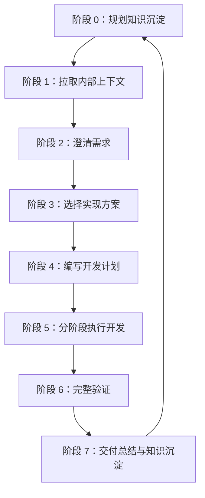
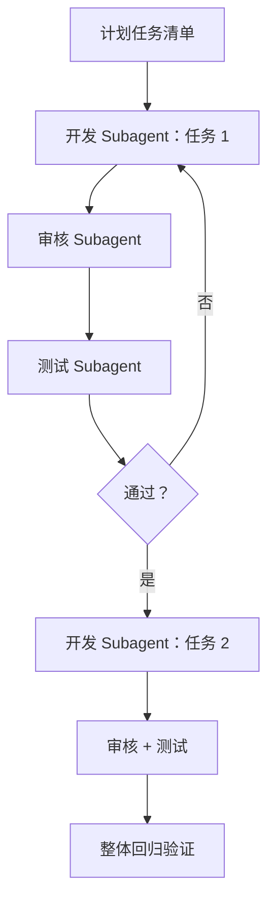

## 一句话方法论

**不要直接让 AI 写代码。** 先拉取上下文、澄清需求，再给出方案、编写计划，分阶段执行，最后用测试与验收标准证明结果正确。

## 这份 SOP 给谁用

**目标读者**：第一次准备用 AI 完成实际开发的同学。无需预先理解 Agent、MCP、Skills 等概念；只需准备好资料、按顺序使用工具并完成各阶段产出。

**适用场景**：

- 从 0 到 1 开发内部平台或新模块；
- 开发一个功能、修复 Bug、进行小范围重构；
- 曾经只把一句话丢给 AI，结果质量不稳定，希望建立稳定做法。

**预期收获**：

- 明确开发前应准备的文档与上下文；
- 知道何时获取内部文档、何时使用工程纪律技能；
- 获得各阶段可直接复用的提示词模板；
- 一份交付质量检查清单；
- 能亲自跑一次对照实验，感受"流程化输入"和"一句话输入"的差异。

## 核心原则

1. **AI 是需要上下文的协作对象，而不是代码补全器。** 业务术语、历史决策、私有接口、团队约定不在模型训练数据里；上下文越少，AI 越会用通用经验去猜。
2. **先确定做什么，再确定怎么做。** 需求不清就编码，是返工的常见根源。
3. **简单任务轻流程，复杂任务重流程。** 流程强度应匹配改动风险。
4. **"完成"必须有证据。** 交付前必须记录执行过的测试、命令、接口/页面检查，以及未覆盖的部分。

## 工具分工

| 工具 | 解决的问题 | 何时使用 |
| --- | --- | --- |
| 内部文档 / 知识库技能 | 提供团队内部上下文，并沉淀 Coding 项目上下文 | 读取需求文档、技术方案、接口文档、会议纪要、历史评审；检索历史方案与踩坑；将结论写回文档 |
| Superpowers | 为 AI 提供工程工作纪律，按阶段拆解与推进 | 需求澄清、方案比较、开发计划、分阶段实现、调试、验证与交付前检查 |

一句话：**内部文档技能负责"AI 应该知道什么"，Superpowers 负责"AI 应该怎么做"。**

## 开发前准备：输入包

输入包不求越多越好；关键是让 AI 至少知道：项目是什么、需求是什么、代码在哪里、怎样才算做对。

**必备信息**：

- 项目背景与用户；
- 需求来源（需求文档、Bug 单）；
- 涉及模块、页面、接口、服务或目录；
- 接口与数据字段信息；
- 验收标准：正常、异常、边界，以及不可破坏的旧行为；
- 本地启动、测试、构建命令（未知时要求 AI 从项目中查找）。

**建议补充的辅助资料**：设计稿、原型、截图；历史技术方案与评审记录；线上报错日志；现有测试文件位置；需兼容的旧逻辑与不可修改范围；上线、灰度与回滚要求。

**输入包模板**：

```text
我准备开始一个开发任务。请先读取和整理上下文，不要立刻写代码。

项目背景：
【项目是做什么的、用户是谁；没有就写一段简版】

需求来源：
【粘贴需求描述，或贴需求文档 / Bug 单链接】

相关模块：
【涉及的页面、接口、服务、组件、目录】

接口和数据：
【字段说明、返回示例；没有则写"暂无，请从代码中分析"】

验收标准：
1. 【正常场景】
2. 【异常场景】
3. 【边界场景】
4. 【不能破坏的旧行为】

本地验证方式：
【启动、测试、构建命令；不知道就让 AI 从项目中查】

请先输出：
1. 你理解的项目背景
2. 你理解的需求目标
3. 相关代码入口
4. 主要风险和不确定点
5. 当前信息是否足够开始开发；如不足，缺少哪些文档或链接，以及建议先读哪些代码反向总结
```

> 信息不完整也可以开始：不要因为"还缺资料"就完全停住。把"信息是否足够"的判断交给 AI——先让它识别缺口，再决定补哪些资料。

## 标准开发闭环：8 个阶段



前序阶段的产出未确认时，不进入后续阶段。阶段 0 约定要沉淀什么；阶段 1–6 过程中持续记录；阶段 7 汇总为接手包。

### 阶段 0：规划知识沉淀

开始前明确本次任务要留下哪些资料、归档在哪里、何时记录。该盘点也是阶段 7 的验收清单。推荐 `docs/` 结构：

```text
docs/
├── README.md           # 总入口：阅读路径与维护规范
├── overview/           # 项目总览：产品、架构、领域模型、技术栈、进度
├── references/         # 上游资料快照：需求与约束事实源
├── decisions/          # 关键技术与业务决策（ADR）
├── design/             # 模块长期设计：模型、表结构、状态机
├── api/                # 接口契约与通用约定
├── runbooks/           # 开发、联调、排障、运维手册
├── pitfalls/           # 已验证的踩坑与规避
├── handoff/            # 阶段性接手包索引
└── superpowers/        # 历史 specs/plans 归档，非当前事实源
```

### 阶段 1：拉取内部上下文

若需求源自文档、需求说明或 Bug 单，直接把链接交给 AI 阅读，不要依赖记忆转述。适用于：需求挂在内部文档、涉及其他团队接口、存在类似功能的历史方案或踩坑记录。

### 阶段 2：澄清需求

先让 AI 讲清它如何理解需求，再讨论实现。

```text
请使用 brainstorming 的方式澄清需求，不要写代码。

请输出：
1. 你对这次需求的理解
2. 明确会做的范围
3. 明确不会做的范围
4. 你认为有歧义的地方
5. 需要我确认的问题

确认完成前，不要进入实现。
```

新手必须确认：用户是谁、主流程是什么、异常时如何表现、数据来源和字段含义、成功/失败如何展示、哪些旧功能不可受影响。

### 阶段 3：选择实现方案

复杂任务至少比较 2–3 个方案，而不是让 AI 直接给唯一解。

```text
请给出 2–3 个实现方案，并比较它们。

每个方案需要包含：
1. 实现思路
2. 会改哪些文件或模块
3. 优点
4. 缺点
5. 风险

最后请给出你推荐的方案和理由。

我挑定方案后，请把"候选方案 + 选了哪个 + 为什么 + 怎么回滚"写成一份 ADR，
放到 docs/decisions/{下一个编号}-{决策简称}.md，编号在已有最大编号上 +1，永远不重用。
```

新手选方案的优先顺序：符合现有风格 → 改动范围小 → 容易测试/回滚 → 不引入不必要的抽象或依赖。

### 阶段 4：编写开发计划

方案确认后，再要求 AI 生成具体到文件与步骤的计划。

```text
请基于已确认的方案写开发计划。

计划需要包含：
1. 修改文件列表
2. 每个文件要改什么
3. 执行顺序
4. 需要新增或修改的测试
5. 每一步完成后的检查点
6. 最终验证命令
7. 风险和回滚方式

计划写完后等我确认，不要立即执行。
```

### 阶段 5：分阶段执行开发

采用 subagent-driven-development 时，主 AI 如项目经理般编排：开发子代理实现任务、审核子代理独立审查、测试子代理独立验证。默认串行，只有任务互不依赖时才并行。



**存在独立任务时可以并行**，但要先让 AI 输出：可以并行的任务组合、每个 subagent 的边界（允许/不能修改的文件）、哪些任务必须串行。每个 subagent 完成后仍要走"审核 + 测试"。

人需要盯住：计划外文件改动、Critical/Important 审核问题是否真正修复、测试是否给出命令和输出、任务执行到第 3/4 项后是否发生方向漂移。出现漂移时立即暂停，要求对比原始需求、计划与已完成任务，给出最小修正方案。

### 阶段 6：完整验证

任务级审核与测试只能证明局部正确，整体验收由本阶段负责。

```text
请使用 verification-before-completion 的方式做验证。

请输出：
1. 执行了哪些验证命令
2. 每个命令的结果
3. 覆盖了哪些验收标准
4. 哪些标准还没自动化覆盖
5. 需要我人工检查的内容
6. 剩余风险

如果没有跑验证，不要说"任务完成"。
```

> **新手陷阱**：测试通过不等于验证完成。必须追问：这些测试覆盖了哪些验收标准、哪些关键路径尚未覆盖。

### 阶段 7：交付总结与知识沉淀

阶段 7 的完成标准是：阶段 0 的沉淀盘点逐项都有对应文件，并能经"完全外行接手者"校验。AI 说"完成"不算完成，盘点逐项打勾才算。

交付总结应包含四部分：任务交付摘要（做了什么/改了哪些文件/如何验证/没做什么/回滚方式/剩余风险）、逐项产出未完成的清单项、Handoff 索引、盘点 vs 实际产出对照表。最后再用一个"外行视角"提示词反向校验接手包是否完整。

## 按任务复杂度选择流程

| 场景 | 适用任务 | 推荐阶段 | 关键要求 |
| --- | --- | --- | --- |
| A：简单修改（轻流程） | 文案、样式、日志、配置、小范围判断逻辑 | 跳过 1–4，从 5 开始；最小验证后简短总结 | 限定文件范围；禁止顺手重构；保留改动与验证证据 |
| B：Bug / 已有功能小改（标准流程） | 测试失败、线上异常、加字段/状态/接口 | 视情况走 1；必须走 2；3 仅比较 1–2 个方案；4–7 完整执行 | 修 Bug 先复现再修改；遵循现有风格；不借机引入新框架 |
| C：核心链路 / 跨模块 / 新模块（完整流程） | 多模块、线上稳定性风险、从 0 到 1 模块 | 完整执行 1–7 | 必读原始文档；比较 2–3 个方案；计划必须含回滚；优先 Subagent 三段式；完整回归老功能 |

## 新手常见错误

| 错误 | 问题 | 改进方式 |
| --- | --- | --- |
| 只给一句自然语言 | AI 不知道用户、数据、操作与验收 | 填写输入包模板 |
| 一句话要求完成所有事 | AI 容易跳过澄清和计划，过程偏离不可见 | 澄清 → 计划 → 实现 → 验证分阶段进行 |
| 没有验收标准 | "修一下问题"无法定义完成 | 明确正常、异常、边界和旧功能兼容要求 |
| 把"跑测试"当作验证完成 | 测试仅是证据之一，可能遗漏关键路径 | 明确测试映射的验收标准和未覆盖风险 |
| 凭记忆转述需求 | 二手描述丢失关键约束 | 直接让 AI 读取原始文档链接 |

## 效果实验设计

这套 SOP 的价值可以用对照实验验证：同一任务，一组"一句话交给 AI"，一组"按 SOP 流程化输入"，对比产出。

| 维度 | 方式 A：一句话输入 | 方式 B：流程化输入 |
| --- | --- | --- |
| 需求输入 | 直接给 AI 一句任务描述 | 按输入包、上下文、澄清、方案、计划分轮进行 |
| 工作方法 | 可直接编码 | 调用工程技能，阶段产出经确认后再继续 |
| 任务难度 | 轻 / 标准 / 完整三档 | 同一任务与同一验收标准 |

**建议量化指标**：验收通过率、异常场景覆盖率、计划外改动数量、返工次数、总耗时、一次过审率、关键路径测试覆盖率、方案与回滚完整度。

## 最终检查清单

**开发前**：已准备项目背景；已提供需求文档或明确需求；已说明相关模块与目录；已写清正常/异常/边界验收标准；已提供启动、测试、构建命令；已让 AI 说明需求理解与不确定点。

**开发中**：复杂任务已比较方案并确认计划；已明确将修改哪些文件；并行时已明确每个 Subagent 的范围与验收标准；开发完成后独立审核和测试已执行；AI 未随意扩大范围。

**交付前**：核心与异常场景已实现、旧功能未受破坏；相关测试已新增或更新；审核中的 Critical/Important 问题均已修复；验证命令与结果已记录；AI 已说明未覆盖风险；阶段 0 的沉淀盘点已与实际产物逐项对照。

## 支撑这套流程的仓库

这套 SOP 不是原创方法论，而是把社区最成熟的工程技能装进了流程里。核心是 **Superpowers**：

- [obra/superpowers](https://github.com/obra/superpowers)：Claude Code 的著名方法论插件，内置从澄清到交付的完整技能链——`using-superpowers`、`brainstorming`、`writing-plans`、`executing-plans`、`subagent-driven-development`、`test-driven-development`、`verification-before-completion`、`requesting-code-review` 等。上面每一步其实都是它的一个 skill。
- 配套的 [obra/superpowers-marketplace](https://github.com/obra/superpowers-marketplace) 是官方插件市场，安装后在 Claude Code 里 `/plugin marketplace add obra/superpowers-marketplace`，再 `/plugin install superpowers@superpowers-marketplace` 就能用。
- 社区可编辑的 [obra/superpowers-skills](https://github.com/obra/superpowers-skills) 允许你 fork 后给这套技能库提新 skill 或改进。

一句话：**流程化输入 = Superpowers 的方法论 + 你的项目上下文**。它把"澄清 → 方案 → 计划 → 执行 → 验收"每一步固化成可复用的技能，这正是这套 SOP 能"可预期"的原因。